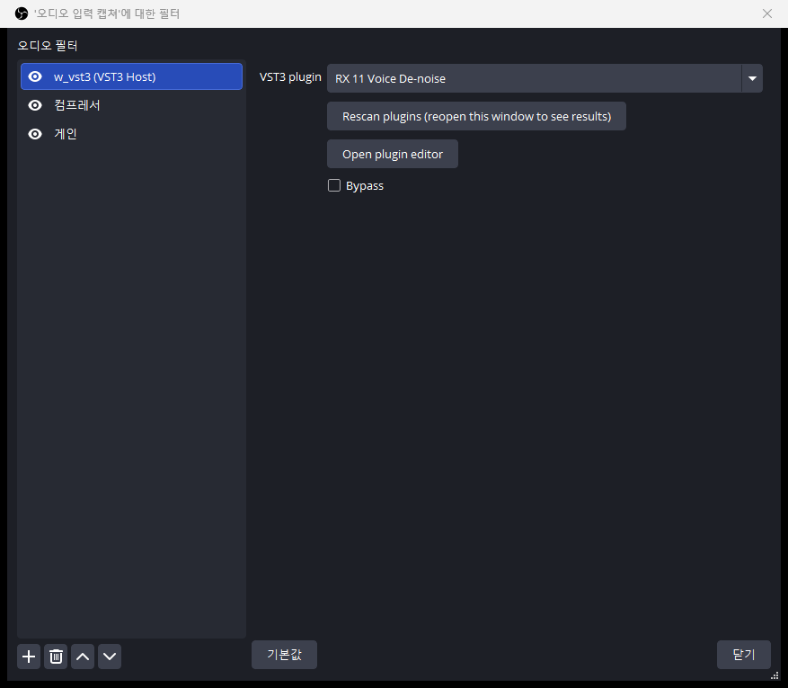
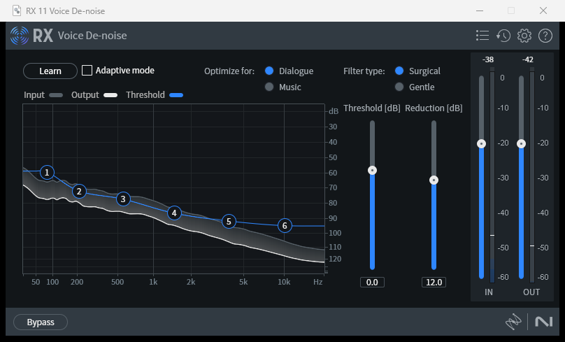

# w_vst3 사용 설명서

OBS Studio의 오디오 소스에 VST3 이펙트 플러그인 하나를 필터로 붙이는 플러그인이다.

[English guide](USAGE.md)

## 요구 사항

- Windows 10/11 64비트
- OBS Studio 33.0.1 (이 버전에서만 테스트했다)
- 64비트 VST3 플러그인 (예: iZotope RX 11)

## 설치

### 방법 1. 설치 프로그램 (릴리스가 올라온 뒤)

1. OBS를 완전히 종료한다.
2. GitHub 릴리스에서 `w_vst3-<버전>-windows-x64-setup.exe`를 받는다.
3. 실행하고 안내를 따른다. 관리자 권한이 필요하다.

### 방법 2. 직접 복사

1. OBS를 완전히 종료한다. 필터 창이나 에디터 창이 열려 있어도 종료되지 않을 수 있으니 작업 표시줄에 OBS가 남아 있는지 확인한다.
2. 아래 폴더를 만든다.

   ```
   C:\ProgramData\obs-studio\plugins\w_vst3
   ```

3. 다음 두 파일을 그 폴더에 복사한다. 두 파일은 반드시 같은 폴더에 있어야 한다.

   - `w_vst3.dll`
   - `w_vst3_scanner.exe`

4. OBS를 실행한다.

### 설치 확인

OBS 메뉴에서 도움말 → 로그 파일 → 현재 로그 보기를 열고 `[w_vst3] loaded`가 있는지 본다. 오디오 소스의 필터 추가 목록에 **w_vst3 (VST3 Host)** 가 보이면 설치된 것이다.

### 제거

OBS를 종료하고 `C:\ProgramData\obs-studio\plugins\w_vst3` 폴더를 삭제한다. 스캔 목록 캐시를 지우려면 `%APPDATA%\obs-studio\plugin_config\w_vst3` 폴더도 삭제한다.

## 사용법

1. 오디오 소스(예: 오디오 입력 캡처)를 우클릭하고 **필터**를 연다.
2. 오디오 필터의 **+** 를 눌러 **w_vst3 (VST3 Host)** 를 추가한다.
3. **VST3 plugin** 목록에서 플러그인을 고른다. 처음 OBS를 켠 직후에는 스캔이 끝날 때까지 몇 초 걸린다.
4. **Open plugin editor** 를 눌러 플러그인 설정 창을 연다. 창은 OBS 위에 항상 떠 있다.
5. 값을 조정하고 창을 닫는다. 설정은 OBS 프로파일에 자동으로 저장되고, OBS를 다시 켜면 복원된다.



*그림 1. 필터 속성: 플러그인 목록, Rescan plugins, Open plugin editor, Bypass.*



*그림 2. Open plugin editor로 연 플러그인 자체 설정 창 (여기서는 iZotope RX 11 Voice De-noise).*

### 옵션

| 항목 | 설명 |
|---|---|
| VST3 plugin | 설치된 VST3 목록. 다른 플러그인을 고르면 이전 플러그인의 설정은 버려진다. |
| Rescan plugins | VST3를 새로 설치했을 때 다시 스캔한다. 스캔은 백그라운드에서 돌고, 끝난 뒤 필터 창을 다시 열면 목록에 나타난다. |
| Open plugin editor | 플러그인 GUI를 연다. |
| Bypass | 플러그인을 거치지 않고 원본 소리를 그대로 내보낸다. |

## 알려진 한계

- **지연**: 플러그인이 자체 지연(latency)을 가지면 그만큼 소리가 늦어진다. 예를 들어 RX 11 De-click은 약 0.7초다. OBS 필터는 지연을 보상할 수 없다. 영상과 어긋나면 소스의 **고급 오디오 속성**에서 동기화 오프셋을 조정한다.
- 앞쪽 2채널(모노 또는 스테레오)만 처리한다.
- 아래 폴더의 VST3만 목록에 나타난다.
  - `C:\Program Files\Common Files\VST3`
  - `%LOCALAPPDATA%\Programs\Common\VST3`
- 플러그인은 OBS 프로세스 안에서 돈다. 실행 중에 플러그인이 비정상 종료하면 OBS도 같이 종료될 수 있다. 스캔은 별도 프로세스라 안전하다.
- 필터 하나에 플러그인 하나만 쓸 수 있다. 여러 개를 쓰려면 필터를 여러 개 추가한다.

## 문제 해결

| 증상 | 확인할 것 |
|---|---|
| 필터 목록에 w_vst3가 없다 | 파일 위치가 `C:\ProgramData\obs-studio\plugins\w_vst3\w_vst3.dll`인지, 설치 후 OBS를 다시 켰는지 확인한다. |
| 플러그인 목록이 비어 있다 | `w_vst3_scanner.exe`가 `w_vst3.dll`과 같은 폴더에 있는지 확인한다. 로그에 `scanner not found`가 있으면 이 경우다. **Rescan plugins** 를 누른다. |
| 특정 플러그인이 목록에 없다 | 로그의 `skipped (probe failed)` 줄을 확인한다. 64비트 VST3인지, 위 폴더에 있는지 본다. |
| 에디터 창이 안 보인다 | **Open plugin editor** 를 다시 누르면 기존 창이 앞으로 나온다. 로그에 `editor window created`가 있으면 창은 만들어진 것이다. |
| 소리가 안 바뀐다 | **Bypass** 가 꺼져 있는지, 로그에 `loaded '<이름>'`이 있는지 확인한다. 노이즈 제거 같은 플러그인은 조용한 구간에서는 차이가 작다. |
| 소리가 늦다 | 위 "지연" 항목을 본다. 로그의 `latency=` 값이 샘플 수이고, 48kHz에서 48000이 1초다. |
| 설치 중 파일 복사 실패 | OBS가 실행 중이다. 작업 관리자에서 `obs64.exe`를 확인하고 종료한다. |

문제를 보고할 때는 OBS 로그에서 `w_vst3`가 들어간 줄을 함께 첨부한다.

## 로그 위치

`%APPDATA%\obs-studio\logs` 의 가장 최근 파일.
