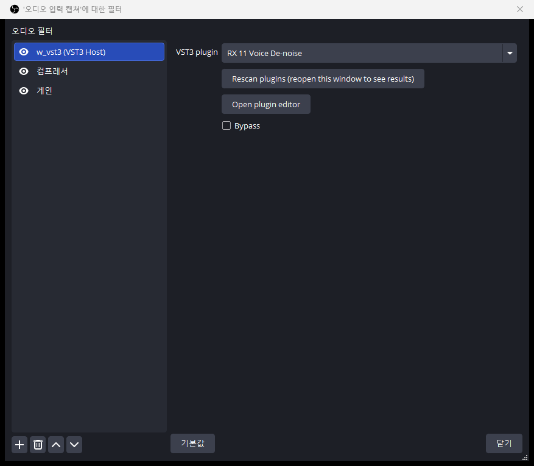
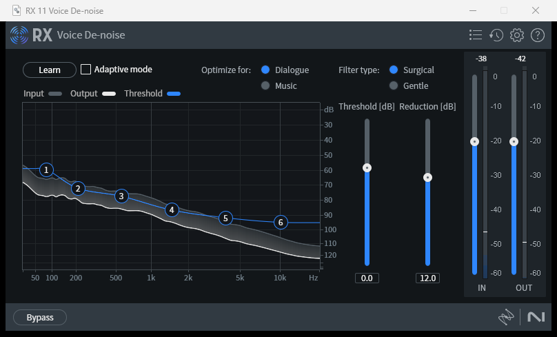

# w_vst3 User Guide

w_vst3 is an OBS Studio plugin that attaches one VST3 effect plugin to an audio source as a filter.

[한국어 설명서](USAGE.ko.md)

## Requirements

- Windows 10/11, 64-bit
- OBS Studio 33.0.1 (the only version tested)
- A 64-bit VST3 plugin (for example iZotope RX 11)

## Installation

### Option 1. Installer (once a release is published)

1. Quit OBS completely.
2. Download `w_vst3-<version>-windows-x64-setup.exe` from the GitHub release page.
3. Run it and follow the prompts. Administrator rights are required.

### Option 2. Manual copy

1. Quit OBS completely. If a filter or editor window is open, OBS may not exit; check that no OBS icon remains in the taskbar.
2. Create this folder:

   ```
   C:\ProgramData\obs-studio\plugins\w_vst3
   ```

3. Copy these two files into it. They must be in the same folder.

   - `w_vst3.dll`
   - `w_vst3_scanner.exe`

4. Start OBS.

### Verify the installation

Open Help → Log Files → View Current Log in OBS and look for `[w_vst3] loaded`. If **w_vst3 (VST3 Host)** appears in the audio filter list, the plugin is installed.

### Uninstall

Quit OBS and delete `C:\ProgramData\obs-studio\plugins\w_vst3`. To also remove the plugin scan cache, delete `%APPDATA%\obs-studio\plugin_config\w_vst3`.

## Usage

1. Right-click an audio source (for example Audio Input Capture) and choose **Filters**.
2. Under Audio Filters, click **+** and add **w_vst3 (VST3 Host)**.
3. Choose a plugin from the **VST3 plugin** list. Right after OBS starts, the first scan can take a few seconds.
4. Click **Open plugin editor** to open the plugin's own settings window. The window stays on top of OBS.
5. Adjust the values and close the window. Settings are saved in the OBS profile automatically and restored the next time OBS starts.



*Figure 1. The filter properties: plugin list, Rescan plugins, Open plugin editor, and Bypass.*



*Figure 2. The plugin's own editor window (here iZotope RX 11 Voice De-noise), opened with Open plugin editor.*

### Options

| Item | Description |
|---|---|
| VST3 plugin | List of installed VST3 plugins. Choosing a different plugin discards the previous plugin's settings. |
| Rescan plugins | Rescans after you install a new VST3 plugin. The scan runs in the background; reopen the filter window afterwards to see the new list. |
| Open plugin editor | Opens the plugin GUI. |
| Bypass | Sends the original sound through without the plugin. |

## Updates

When OBS starts, w_vst3 checks the latest GitHub release once. If a newer version exists, the filter properties show **Update available** and a **Download update** button.

1. Click **Download update**. The installer and its `.sha256` file are downloaded and the SHA-256 is verified. A mismatch discards the download.
2. When you quit OBS, the installer starts and Windows asks for administrator approval.

Nothing is installed unless you click the button.

- The check sends one HTTPS request to `api.github.com`. To turn it off, create `%APPDATA%\obs-studio\plugin_config\w_vst3\settings.json` containing `{ "check_updates": false }`.
- The installer is not code-signed, so Windows SmartScreen may warn.

## Known limitations

- **Latency.** If a plugin has its own latency, the sound is delayed by that amount. For example, RX 11 De-click is about 0.7 seconds. An OBS filter cannot compensate for it. If audio and video drift apart, adjust the sync offset in the source's Advanced Audio Properties.
- Only the first two channels (mono or stereo) are processed.
- Only plugins in these folders are listed:
  - `C:\Program Files\Common Files\VST3`
  - `%LOCALAPPDATA%\Programs\Common\VST3`
- Plugins run inside the OBS process. If a plugin crashes while running, OBS can crash with it. Scanning runs in a separate process and is safe.
- One plugin per filter. To use several, add several filters.

## Troubleshooting

| Symptom | What to check |
|---|---|
| w_vst3 is not in the filter list | Confirm the file is at `C:\ProgramData\obs-studio\plugins\w_vst3\w_vst3.dll` and that you restarted OBS after installing. |
| The plugin list is empty | Confirm `w_vst3_scanner.exe` is in the same folder as `w_vst3.dll`. The log shows `scanner not found` in this case. Click **Rescan plugins**. |
| A specific plugin is missing | Look for `skipped (probe failed)` in the log. Check that it is a 64-bit VST3 in one of the folders above. |
| The editor window does not appear | Click **Open plugin editor** again to bring the existing window forward. If the log shows `editor window created`, the window exists. |
| The sound does not change | Check that **Bypass** is off and that the log shows `loaded '<name>'`. Noise reduction plugins make little difference in quiet passages. |
| The sound is late | See "Latency" above. `latency=` in the log is in samples; at 48 kHz, 48000 is one second. |
| File copy fails during install | OBS is still running. Check `obs64.exe` in Task Manager and end it. |

When reporting a problem, attach the lines containing `w_vst3` from the OBS log.

## Log location

The most recent file in `%APPDATA%\obs-studio\logs`.
